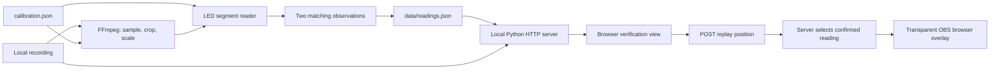
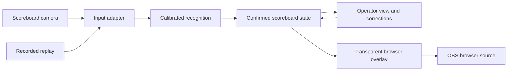

# Architecture

## Goal

Convert a camera view of a physical futsal scoreboard into digital scores and game time, suitable for a professional OBS graphic. The match camera remains a separate input to OBS.

The current milestone adds server-owned continuous recorded input and an experimental macOS camera path, while retaining the distinction between observations and confirmed state. Default replay mode still provides the original offline verification player. The product name and broader production features remain open.

## Implemented system

| Component            | Responsibility                                                                                                                                                                                                       |
| -------------------- | -------------------------------------------------------------------------------------------------------------------------------------------------------------------------------------------------------------------- |
| `reader.py`          | Probe recorded source dimensions and decode sampled frames. `FrameReader` measures LED segments and confirms observations one frame at a time. Batch mode writes a dataset; streaming mode emits flushed JSON lines. |
| `calibration.json`   | Source dimensions, crop, sample rate, digit regions, and seven source-pixel probe centers per digit.                                                                                                                 |
| `data/readings.json` | Generated metadata and observations, plus confirmed values, status, age, and segment diagnostics. Excluded from Git.                                                                                                 |
| `server.py`          | Serve allowlisted assets and video on loopback, support byte-range seeking, and expose local replay-position and overlay-state endpoints.                                                                            |
| `playback.py`        | Select confirmed observations by player position and track whether the publishing player is still connected. Never advance the match clock independently.                                                            |
| `web/`               | Show verification diagnostics, optionally publish playback position, and render a separate transparent overlay.                                                                                                      |
| `tests/`             | Recognition safety, generated-video pipeline coverage, and optional regression checks against the user's recording.                                                                                                  |

The initial development target is macOS with Python 3.12; CI uses macOS 26. Other operating systems and Python versions are outside the current support scope.

The default implementation uses Python's standard library, FFmpeg/ffprobe, and plain browser HTML/CSS/JavaScript. Opt-in region shadow mode additionally needs the packages pinned in `requirements-shadow.txt`. Node.js is a development tool for JavaScript syntax checks, not an application runtime.

### State semantics

Each row has a source-relative timestamp `t` and a `raw` reading, which may be null. A reading contains `home`, `away`, and a `clock` string in `MM:SS` format. The recognizer rejects incomplete patterns and invalid seconds. It also [rejects contradictory white-core evidence](probe-core-rejection.md): an apparently off colour probe with substantial neutral white light makes its digit unavailable. Rows expose `white_segments` and per-digit `rejections` alongside the existing colour `segments`. This veto never fills in strokes or selects a replacement value.

Two successive matching non-null readings confirm the output. `values` contains the most recently confirmed reading, or null before the first confirmation. `status` is `unknown`, `held`, or `confirmed`; `age` measures source seconds since the last confirmation. The viewer marks a hold of at least one second as stale. It never advances the match clock independently.

`confidence` is a normalized minimum distance from the segment threshold. It is not a probability of correctness. Raw readings can briefly resemble another valid digit during transitions; confirmation filters the observed single-sample glitches. It cannot guarantee correctness if an incorrect reading persists.

### Replay overlay transport

The operator explicitly enables replay output in the verification view. While enabled, it POSTs the video position to `/api/playback` every 100 ms, including while paused. The server selects the corresponding precomputed reading and exposes it at `/api/state`; the separate `/overlay` page polls that state every 100 ms. It does not download the video or recognize digits itself. The server rejects malformed, out-of-range, and cross-origin position updates.

If the operator stops output or no update arrives for two seconds, the server marks delivery disconnected and preserves the last reading. The overlay displays a `DATA HELD` badge on disconnected delivery or source readings held for at least one second. Before the first confirmed reading it uses dashes. Server connection failures preserve the displayed values and show a connection warning. Paused video with an active heartbeat remains connected and keeps its exact clock value.

Replay state is in memory and resets on server restart. This proof of concept assumes one publishing operator tab; additional publishing tabs can overwrite each other's positions. The graphic is explicitly labelled `REPLAY`. Browser background throttling can trigger a held-data warning. See `docs/obs-overlay.md` for setup and limitations.

### Server-owned continuous delivery

`--mode recording` recognizes the source recording as it plays, without precomputed data or a browser publisher. `--mode camera --device NAME` uses the macOS AVFoundation adapter. Both use the existing `FrameReader` and expose confirmed state through `/api/state` to the monitor and overlay. `/api/playback` returns 409 in these modes so another browser cannot overwrite the output.

Camera selection is explicit, audio is disabled, and a filter guard rejects resolution mismatches before using calibration. The camera path processes arriving frames without an `fps` duplication filter; its observation timestamps are monotonic elapsed time. Recording input retains the existing sampled source timeline. A background worker uses bounded frame/diagnostic buffers and cooperatively stops its FFmpeg child.

Missing frames become disconnected after two seconds, and confirmation age increases with time since the last frame. A ten-second frame timeout stops the decoder. EOF and errors preserve the last confirmed values with held status; restarting input currently requires restarting the server. Camera output is labelled `LIVE`, recorded output `REPLAY`. See `docs/live-input.md` for the required single-owner capture arrangement and unvalidated hardware behavior.

### Input preview and alignment

Continuous modes use one FFmpeg decoder and split each decoded input into a half-resolution display image and the original crop/scale recognition path. Both branches convert to RGB24 and are packed vertically into one raw output frame; Python extracts the recognition pixels and retains only the latest preview, published at most twice per second. The input is never opened twice. Reference dimensions and crop coordinates/sizes must be even integers and the crop must fit the source.

The monitor draws the active profile's six digit regions and 42 segment centers over a canvas. `GET /api/calibration` and uncached binary `/api/preview` are available only in continuous modes. Preview age remains explicit after EOF, failure, or a browser freeze. Freezing affects presentation only; recognition and confirmed-state delivery continue. The monitor can edit a draft calibration; saving images is not implemented. Preview is slower than recognition and is not synchronized for frame-by-frame accuracy review.

### Local camera calibration

`web/calibrate.js` first offers four-corner alignment of the central clock-and-scores panel. The active profile's optional `board_corners` stores its corresponding panel outline in source-image coordinates, ordered TL/TR/BR/BL. The reference coordinates were selected from the supplied recording: `[470,208]`, `[1468,216]`, `[1460,872]`, `[465,867]`. These refer to the outer central frame, excluding the numbered side panels, with straight edges extended through rounded corners. They are setup anchors, not additional recognition probes.

`POST /api/calibration/align` fits a homography from that outline to four new corners and maps all 42 calibrated probe centers plus the four corners of every digit box. Display boxes use enclosing axis-aligned bounds; recognition still samples the transformed probe centers without warping image pixels or resizing the sampling window. The result is validated as a draft and returned without changing active state or writing a file. Each request maps from the active profile, avoiding cumulative draft transforms. Missing legacy outlines and invalid, crossed, degenerate, or out-of-frame configurations are rejected. Saved profiles preserve the mapped outline. The shortcut is for this same panel layout; it is not independent digit detection, lens correction, or moving-camera tracking.

For optional fine adjustments, the operator can still mark four ordered convex corners for each digit. Bilinear interpolation places a standard seven-segment template inside that outline; individual probes can be placed by clicking or entering integer source coordinates. This accommodates translation, scale, rotation, and modest skew through manual setup. It is not automatic detection, tracking, or exact perspective rectification. A strongly distorted digit may need individual probe adjustments.

`calibration.py` validates six digit boxes and seven bounded probes per digit against the active resolution, preserves the active sample rate, derives an even crop around the probes, and constructs a `FrameReader` before accepting the profile. `POST /api/calibration/test` inspects the latest server preview once and returns per-digit diagnostics; it never publishes or confirms output. Preview resampling differs from the production crop/scale path, so this check does not substitute for validation after activation.

`POST /api/calibration/save` atomically replaces the fixed ignored `data/calibration.local.json` destination. Request-provided file paths and crop/filter geometry are not used. All three POST endpoints require JSON, bound request size, reject mismatched Origins, and are disabled in replay mode. Edits and saves leave the in-memory profile and current confirmed state unchanged. Restarting with `--calibration data/calibration.local.json` deliberately activates the new crop and probes in one capture process; confirmation starts with no values and requires fresh evidence. The reference `calibration.json` is preserved. Local profile saving overwrites the previous local save, not a versioned profile library.

### Current limits

The recording reader supports batch output and continuous JSON-line output, optionally paced at playback speed. Both share recognition and confirmation logic; the continuous path does not accumulate a full recording. The server-owned recording mode connects this recognition path to server state.

Default replay mode remains batch-backed; continuous recording and camera modes drive the same overlay directly. Recognition is calibrated for a fixed 1920×1080 input and one-digit scores. Replay seeking uses the previously computed source timeline. A live adapter is implemented, but live scoreboard accuracy, production latency, and single-owner OBS integration remain unvalidated. Manual overrides, automatic calibration, and period recognition are not implemented. Accuracy across new venues, score digits, lighting, and camera movement is unmeasured. See `VALIDATION.md` for recording-specific evidence.

### Offline recognition experiments

`experiments/` compares the current reader with rectified whole-digit regions and local Tesseract. It uses optional isolated OpenCV/NumPy packages and never publishes state, opens a camera, or changes the runtime reader. The normal repository check compiles these files without importing the optional packages; experiment tests run separately. The region candidate adds padded observation windows, rejects boundary contact and ambiguous shapes before normalization, and records per-digit rejection evidence. Clock windows give wider glyphs additional room on the left while excluding the colon; a shared clock brightness floor prevents dark/blank panel texture from becoming foreground without lowering each window's adaptive threshold. Translation stress runs include short windows with separate confirmation history and truth only at reviewed anchors. See [comparison evidence and limits](recognition-comparison.md), including the fixed shifted-score example and coverage loss, before proposing runtime integration.

Candidate score patches with sufficient observed white pixels use a [core-aware brightness mask](score-core-recognition.md) so white LED centres survive while red glow inside hollow zeros is rejected. Other score patches retain the red mask, subject to a low-contrast rejection. This is an extraction heuristic with recorded availability losses; shape/crop checks and clock extraction remain unchanged.

The standard-library `candidate_state.py` is used by experiments, tests and the explicitly enabled shadow reader. It parses one observed clock in an explicit selected layout and confirms home, away and clock independently, retaining per-field age, status and reasons. Three timed observations can confirm countdown progression, including tenths, without generating unseen values. Unknown digits never select another layout. Offline reports retain legacy comparison rows separately from the new independent field rows. See [rules and limits](candidate-confirmation.md), including the remaining exposure and framing limits. The opt-in monitor path exposes these diagnostics separately; the default runtime path is unchanged.

The offline [generated exposure runner](candidate-exposure-stress.md) sends independent RGB score drawings through the shared candidate recognition and state modules. Its clean, mixed, missing and recovery phases retain different truth semantics; it never publishes output. This is validation tooling, not a runtime exposure detector. The candidate now uses `RegionReader.observe` across shadow and offline paths to [reject competing valid score-mask interpretations](score-mask-disagreement.md). Primary values and complementary core/local RGB contrast evidence remain diagnostic; alternative masks never supply replacement digits. The [local contrast guard and controlled variants](local-score-contrast.md) reject remaining original-matrix mixtures while exposing unresolved blur failures. Clock extraction and candidate confirmation rules are unchanged.

### Opt-in shadow comparison

`--shadow-regions` adds a full-resolution RGB branch to the continuous input's single FFmpeg decoder. The unchanged preview and recognition branches plus the full frame are padded to source width and stacked. Python unpacks each once and passes the full frame to `shadow.ShadowReader`, which shares `region_reader.RegionReader` with offline experiments and feeds independent candidate state. Optional packages load only on explicit opt-in. A processing exception stops candidate recognition and retains diagnostics without terminating the established reader.

`ContinuousState` keeps latest candidate diagnostics separately, exposed through read-only `/api/shadow`. Candidate values never enter `/api/state`; there is no promotion/write endpoint. The monitor displays observed/confirmed values and freshness per field, plus layout and rejection evidence. EOF/loss increases age and holds values, and HTTP loss clears displayed freshness claims. Calibration edits do not activate in either reader until restart.

Fixed explicit layouts are supported; reviewed recorded-input layout schedules are rejected for camera input. The larger packed frames and synchronous recognition add transport/processing cost. Camera shadow throughput and live delay have not been validated. See [setup, boundary evidence and limitations](shadow-reader.md). No candidate output is enabled by this milestone.

## Live boundaries and remaining work

The implemented boundaries and remaining responsibilities are:

1. **Input adapter:** provide timestamped frames from recordings or AVFoundation. Capture delivery is tested; production format selection and the single-owner OBS setup still need validation.
2. **Recognition:** convert frames to observations with uncertainty and diagnostics. Keep camera-specific calibration separate from game state.
3. **State:** confirm observations, expose freshness, and eventually arbitrate explicit manual overrides and recovery. Define override/resume behavior before implementing it.
4. **Presentation:** provide operator diagnostics and a separate transparent graphic driven by confirmed state. Correction controls remain to be implemented.

Recorded replay should exercise the same recognition and state logic as live input. Separate these responsibilities as the live path requires them; a package migration, event bus, database, hosted backend, and frontend framework are not prerequisites.

## Decisions and open questions

- **Local processing first:** use existing recordings without uploading footage or requiring a cloud service.
- **Calibrated segment recognition first:** the supplied display has large, fixed LED digits. Broader recognition approaches need comparative evidence before adding complexity.
- **Keep evidence reviewable:** timestamped raw observations, confirmation status, and source playback are part of the development workflow.
- **OBS browser output uses local HTTP polling:** both replay and continuous server-owned inputs expose confirmed state over the same endpoint. End-to-end live timing remains to be measured.
- **Capture ownership:** the camera uses a generic USB-C HDMI capture device exposed as `usb video` on the streaming/development Mac. A direct capture succeeded, but OBS was disrupted afterward and recovered after reconnecting the device and restarting OBS. Prefer the reader as the sole owner of the scoreboard input, with OBS consuming the browser overlay. See `docs/live-input.md` for evidence and limits.
- **Still to establish:** reliable capture configuration, acceptable end-to-end delay, multiple venues, higher scores, clock formats, manual override semantics, and loss/recovery behavior.

Record significant later decisions with their context and tradeoffs in `docs/`. Update this document as boundaries become implemented.

## Controlled source generation

`scripts/generate_controlled_recording.py` creates an ignored local MP4 bundle with a per-frame source timeline, copied reference calibration and explicit source-time layout plan. It uses an independent line drawing, standard-library rasterization and FFmpeg; it does not use the camera, server or confirmation state. Source intention and deliberately visible fields are separate. Recaptured truth requires independent per-field review and a capture-specific calibration/time mapping; counter visibility alone cannot label mixed pixels. See [capture and evaluation workflow](controlled-recording.md). Candidate output remains disabled.

The [score-core balance follow-up](score-core-balance.md) changes only the diagnostic score-core contrast fraction from 0.8 to 0.6, retaining its 99th-percentile reference and disagreement veto. It recovers the controlled recapture's reviewed unevenly bright threes/fours, while leaving active output, clock observations, confirmation and held ages unchanged. More white/red generated mixtures become available; orange blur and recorded physical-truth ambiguity remain unresolved. Candidate output is still disabled.

The [bounded colour-contrast score view](score-chroma-rejection.md) measures `red - max(green, blue)` within primary foreground and may veto a competing score. It stays inconclusive around substantial neutral cores or when normalization would add an unobserved segment. Primary/core/local extraction, clock layouts, confirmation and active output remain unchanged. It rejects the selected blurred orange failures; a broader scan retains six other third-digit cases per colour.
