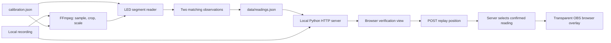
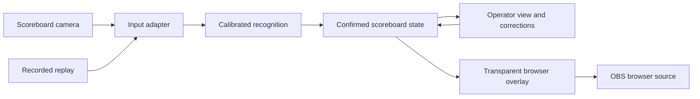

# Architecture

## Goal

Convert a camera view of a physical futsal scoreboard into digital scores and game time, suitable for a professional OBS graphic. The match camera remains a separate input to OBS.

The current milestone adds server-owned continuous recorded input and an experimental macOS camera path, while retaining the distinction between observations and confirmed state. Default replay mode still provides the original offline verification player. The product name and broader production features remain open.

## Implemented system

| Component            | Responsibility                                                                                                                                                                                                       |
| -------------------- | -------------------------------------------------------------------------------------------------------------------------------------------------------------------------------------------------------------------- |
| `reader.py`          | Probe recorded source dimensions and decode sampled frames. `FrameReader` measures LED segments and confirms observations one frame at a time. Batch mode writes a dataset; streaming mode emits flushed JSON lines. |
| `calibration.json`   | Source dimensions, crop, sample rate, digit regions, and seven source-pixel probe centers per digit.                                                                                                                 |
| `data/readings.json` | Generated metadata and observations, plus confirmed values, status, age, and segment diagnostics. Excluded from Git.                                                                                                 |
| `server.py`          | Serve allowlisted assets and video on loopback, support byte-range seeking, and expose local replay-position and overlay-state endpoints.                                                                            |
| `playback.py`        | Select confirmed observations by player position and track whether the publishing player is still connected. Never advance the match clock independently.                                                            |
| `web/`               | Show verification diagnostics, optionally publish playback position, and render a separate transparent overlay.                                                                                                      |
| `tests/`             | Recognition safety, generated-video pipeline coverage, and optional regression checks against the user's recording.                                                                                                  |

The initial development target is macOS with Python 3.12; CI uses macOS 26. Other operating systems and Python versions are outside the current support scope.

The implementation uses Python's standard library, FFmpeg/ffprobe, and plain browser HTML/CSS/JavaScript. Node.js is a development tool for JavaScript syntax checks, not an application runtime.

### State semantics

Each row has a source-relative timestamp `t` and a `raw` reading, which may be null. A reading contains `home`, `away`, and a `clock` string in `MM:SS` format. The recognizer rejects incomplete patterns and invalid seconds.

Two successive matching non-null readings confirm the output. `values` contains the most recently confirmed reading, or null before the first confirmation. `status` is `unknown`, `held`, or `confirmed`; `age` measures source seconds since the last confirmation. The viewer marks a hold of at least one second as stale. It never advances the match clock independently.

`confidence` is a normalized minimum distance from the segment threshold. It is not a probability of correctness. Raw readings can briefly resemble another valid digit during transitions; confirmation filters the observed single-sample glitches. It cannot guarantee correctness if an incorrect reading persists.

### Replay overlay transport

The operator explicitly enables replay output in the verification view. While enabled, it POSTs the video position to `/api/playback` every 100 ms, including while paused. The server selects the corresponding precomputed reading and exposes it at `/api/state`; the separate `/overlay` page polls that state every 100 ms. It does not download the video or recognize digits itself. The server rejects malformed, out-of-range, and cross-origin position updates.

If the operator stops output or no update arrives for two seconds, the server marks delivery disconnected and preserves the last reading. The overlay displays a `DATA HELD` badge on disconnected delivery or source readings held for at least one second. Before the first confirmed reading it uses dashes. Server connection failures preserve the displayed values and show a connection warning. Paused video with an active heartbeat remains connected and keeps its exact clock value.

Replay state is in memory and resets on server restart. This proof of concept assumes one publishing operator tab; additional publishing tabs can overwrite each other's positions. The graphic is explicitly labelled `REPLAY`. Browser background throttling can trigger a held-data warning. See `docs/obs-overlay.md` for setup and limitations.

### Server-owned continuous delivery

`--mode recording` recognizes the source recording as it plays, without precomputed data or a browser publisher. `--mode camera --device NAME` uses the macOS AVFoundation adapter. Both use the existing `FrameReader` and expose confirmed state through `/api/state` to the monitor and overlay. `/api/playback` returns 409 in these modes so another browser cannot overwrite the output.

Camera selection is explicit, audio is disabled, and a filter guard rejects resolution mismatches before using calibration. The camera path processes arriving frames without an `fps` duplication filter; its observation timestamps are monotonic elapsed time. Recording input retains the existing sampled source timeline. A background worker uses bounded frame/diagnostic buffers and cooperatively stops its FFmpeg child.

Missing frames become disconnected after two seconds, and confirmation age increases with time since the last frame. A ten-second frame timeout stops the decoder. EOF and errors preserve the last confirmed values with held status; restarting input currently requires restarting the server. Camera output is labelled `LIVE`, recorded output `REPLAY`. See `docs/live-input.md` for the required single-owner capture arrangement and unvalidated hardware behavior.

### Input preview and alignment

Continuous modes use one FFmpeg decoder and split each decoded input into a half-resolution display image and the original crop/scale recognition path. Both branches convert to RGB24 and are packed vertically into one raw output frame; Python extracts the recognition pixels and retains only the latest preview, published at most twice per second. The input is never opened twice. Reference dimensions and crop coordinates/sizes must be even integers and the crop must fit the source.

The monitor draws the active profile's six digit regions and 42 segment centers over a canvas. Read-only `/api/calibration` and uncached binary `/api/preview` are available only in continuous modes. Preview age remains explicit after EOF, failure, or a browser freeze. Freezing affects presentation only; recognition and confirmed-state delivery continue. Calibration editing and saving images are not implemented. Preview is slower than recognition and is not synchronized for frame-by-frame accuracy review.

### Current limits

The recording reader supports batch output and continuous JSON-line output, optionally paced at playback speed. Both share recognition and confirmation logic; the continuous path does not accumulate a full recording. The server-owned recording mode connects this recognition path to server state.

Default replay mode remains batch-backed; continuous recording and camera modes drive the same overlay directly. Recognition is calibrated for a fixed 1920×1080 input and one-digit scores. Replay seeking uses the previously computed source timeline. A live adapter is implemented, but live scoreboard accuracy, production latency, and single-owner OBS integration remain unvalidated. Manual overrides, automatic calibration, and period recognition are not implemented. Accuracy across new venues, score digits, lighting, and camera movement is unmeasured. See `VALIDATION.md` for recording-specific evidence.

## Live boundaries and remaining work

The implemented boundaries and remaining responsibilities are:

1. **Input adapter:** provide timestamped frames from recordings or AVFoundation. Capture delivery is tested; production format selection and the single-owner OBS setup still need validation.
2. **Recognition:** convert frames to observations with uncertainty and diagnostics. Keep camera-specific calibration separate from game state.
3. **State:** confirm observations, expose freshness, and eventually arbitrate explicit manual overrides and recovery. Define override/resume behavior before implementing it.
4. **Presentation:** provide operator diagnostics and a separate transparent graphic driven by confirmed state. Correction controls remain to be implemented.

Recorded replay should exercise the same recognition and state logic as live input. Separate these responsibilities as the live path requires them; a package migration, event bus, database, hosted backend, and frontend framework are not prerequisites.

## Decisions and open questions

- **Local processing first:** use existing recordings without uploading footage or requiring a cloud service.
- **Calibrated segment recognition first:** the supplied display has large, fixed LED digits. Broader recognition approaches need comparative evidence before adding complexity.
- **Keep evidence reviewable:** timestamped raw observations, confirmation status, and source playback are part of the development workflow.
- **OBS browser output uses local HTTP polling:** both replay and continuous server-owned inputs expose confirmed state over the same endpoint. End-to-end live timing remains to be measured.
- **Capture ownership:** the camera uses a generic USB-C HDMI capture device exposed as `usb video` on the streaming/development Mac. A direct capture succeeded, but OBS was disrupted afterward and recovered after reconnecting the device and restarting OBS. Prefer the reader as the sole owner of the scoreboard input, with OBS consuming the browser overlay. See `docs/live-input.md` for evidence and limits.
- **Still to establish:** reliable capture configuration, acceptable end-to-end delay, multiple venues, higher scores, clock formats, manual override semantics, and loss/recovery behavior.

Record significant later decisions with their context and tradeoffs in `docs/`. Update this document as boundaries become implemented.
