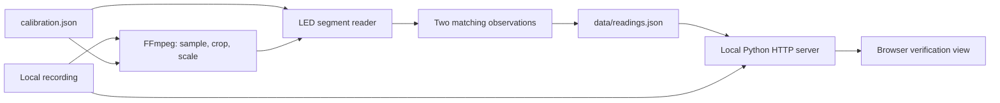
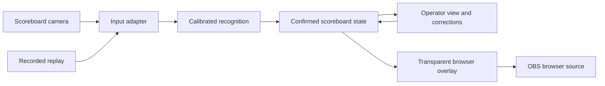

# Architecture

## Goal

Convert a camera view of a physical futsal scoreboard into digital scores and game time, suitable for a professional OBS graphic. The match camera remains a separate input to OBS.

The first milestone is an offline verification tool. The next milestone is a live path that retains the same distinction between observations and confirmed state. The product name and broader production features remain open.

## Implemented system

| Component | Responsibility |
| --- | --- |
| `reader.py` | Probe source dimensions, decode sampled frames, measure calibrated LED segments, recognize digits, confirm observations, and write timestamped readings. |
| `calibration.json` | Source dimensions, crop, sample rate, digit regions, and seven source-pixel probe centers per digit. |
| `data/readings.json` | Generated metadata and observations, plus confirmed values, status, age, and segment diagnostics. Excluded from Git. |
| `server.py` | Serve only the allowlisted viewer assets, generated readings, and the selected video on loopback; support byte-range video seeking. |
| `web/` | Synchronize the precomputed readings with video playback and expose diagnostic information. |
| `tests/` | Recognition safety, generated-video pipeline coverage, and optional regression checks against the user's recording. |

The implementation uses Python's standard library, FFmpeg/ffprobe, and plain browser HTML/CSS/JavaScript. Node.js is a development tool for JavaScript syntax checks, not an application runtime.

### State semantics

Each row has a source-relative timestamp `t` and a `raw` reading, which may be null. A reading contains `home`, `away`, and a `clock` string in `MM:SS` format. The recognizer rejects incomplete patterns and invalid seconds.

Two successive matching non-null readings confirm the output. `values` contains the most recently confirmed reading, or null before the first confirmation. `status` is `unknown`, `held`, or `confirmed`; `age` measures source seconds since the last confirmation. The viewer marks a hold of at least one second as stale. It never advances the match clock independently.

`confidence` is a normalized minimum distance from the segment threshold. It is not a probability of correctness. Raw readings can briefly resemble another valid digit during transitions; confirmation filters the observed single-sample glitches. It cannot guarantee correctness if an incorrect reading persists.

### Current limits

This is an offline, batch process for a fixed 1920×1080 input and one-digit scores. Seeking uses the previously computed source timeline. It is not a live recognition engine and does not provide an OBS overlay, manual overrides, automatic calibration, or period recognition. Accuracy across new venues, score digits, lighting, and camera movement is unmeasured. See `VALIDATION.md` for recording-specific evidence.

## Intended live architecture

These are proposed responsibilities, not modules to create ahead of need:

1. **Input adapter:** provide timestamped frames from recordings or a live source. Confirm the macOS camera connection and OBS capture arrangement before choosing the live integration.
2. **Recognition:** convert frames to observations with uncertainty and diagnostics. Keep camera-specific calibration separate from game state.
3. **State:** confirm observations, expose freshness, and eventually arbitrate explicit manual overrides and recovery. Define override/resume behavior before implementing it.
4. **Presentation:** give operators diagnostics and correction controls; give OBS a separate transparent graphic driven by confirmed state.

Recorded replay should exercise the same recognition and state logic as live input. Separate these responsibilities as the live path requires them; a package migration, event bus, database, hosted backend, and frontend framework are not prerequisites.

## Decisions and open questions

- **Local processing first:** use existing recordings without uploading footage or requiring a cloud service.
- **Calibrated segment recognition first:** the supplied display has large, fixed LED digits. Broader recognition approaches need comparative evidence before adding complexity.
- **Keep evidence reviewable:** timestamped raw observations, confirmation status, and source playback are part of the development workflow.
- **OBS browser output is planned:** the transport from a live reader to that output is undecided. Choose it after measuring update needs and testing capture on macOS.
- **Still to establish:** camera interface, acceptable end-to-end delay, multiple venues, higher scores, clock formats, manual override semantics, and loss/recovery behavior.

Record significant later decisions with their context and tradeoffs in `docs/`. Update this document as boundaries become implemented.
