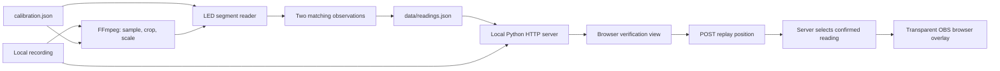
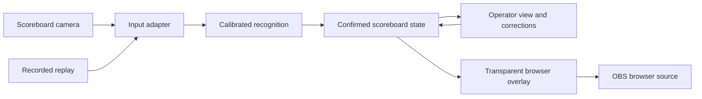

# Architecture

## Goal

Convert a camera view of a physical futsal scoreboard into digital scores and game time, suitable for a professional OBS graphic. The match camera remains a separate input to OBS.

The current milestone adds an OBS browser overlay driven by the offline verification player. The next milestone is a live path that retains the same distinction between observations and confirmed state. The product name and broader production features remain open.

## Implemented system

| Component            | Responsibility                                                                                                                                                                                                       |
| -------------------- | -------------------------------------------------------------------------------------------------------------------------------------------------------------------------------------------------------------------- |
| `reader.py`          | Probe recorded source dimensions and decode sampled frames. `FrameReader` measures LED segments and confirms observations one frame at a time. Batch mode writes a dataset; streaming mode emits flushed JSON lines. |
| `calibration.json`   | Source dimensions, crop, sample rate, digit regions, and seven source-pixel probe centers per digit.                                                                                                                 |
| `data/readings.json` | Generated metadata and observations, plus confirmed values, status, age, and segment diagnostics. Excluded from Git.                                                                                                 |
| `server.py`          | Serve allowlisted assets and video on loopback, support byte-range seeking, and expose local replay-position and overlay-state endpoints.                                                                            |
| `playback.py`        | Select confirmed observations by player position and track whether the publishing player is still connected. Never advance the match clock independently.                                                            |
| `web/`               | Show verification diagnostics, optionally publish playback position, and render a separate transparent overlay.                                                                                                      |
| `tests/`             | Recognition safety, generated-video pipeline coverage, and optional regression checks against the user's recording.                                                                                                  |

The initial development target is macOS with Python 3.12; CI uses macOS 26. Other operating systems and Python versions are outside the current support scope.

The implementation uses Python's standard library, FFmpeg/ffprobe, and plain browser HTML/CSS/JavaScript. Node.js is a development tool for JavaScript syntax checks, not an application runtime.

### State semantics

Each row has a source-relative timestamp `t` and a `raw` reading, which may be null. A reading contains `home`, `away`, and a `clock` string in `MM:SS` format. The recognizer rejects incomplete patterns and invalid seconds.

Two successive matching non-null readings confirm the output. `values` contains the most recently confirmed reading, or null before the first confirmation. `status` is `unknown`, `held`, or `confirmed`; `age` measures source seconds since the last confirmation. The viewer marks a hold of at least one second as stale. It never advances the match clock independently.

`confidence` is a normalized minimum distance from the segment threshold. It is not a probability of correctness. Raw readings can briefly resemble another valid digit during transitions; confirmation filters the observed single-sample glitches. It cannot guarantee correctness if an incorrect reading persists.

### Replay overlay transport

The operator explicitly enables replay output in the verification view. While enabled, it POSTs the video position to `/api/playback` every 100 ms, including while paused. The server selects the corresponding precomputed reading and exposes it at `/api/state`; the separate `/overlay` page polls that state every 100 ms. It does not download the video or recognize digits itself. The server rejects malformed, out-of-range, and cross-origin position updates.

If the operator stops output or no update arrives for two seconds, the server marks delivery disconnected and preserves the last reading. The overlay displays a `DATA HELD` badge on disconnected delivery or source readings held for at least one second. Before the first confirmed reading it uses dashes. Server connection failures preserve the displayed values and show a connection warning. Paused video with an active heartbeat remains connected and keeps its exact clock value.

State is in memory and resets on server restart. This proof of concept assumes one publishing operator tab; additional publishing tabs can overwrite each other's positions. The graphic is explicitly labelled `REPLAY`. Browser background throttling can trigger a held-data warning. See `docs/obs-overlay.md` for setup and limitations.

### Current limits

The recording reader supports batch output and continuous JSON-line output, optionally paced at playback speed. Both share recognition and confirmation logic; the continuous path does not accumulate a full recording. It is not yet connected to server state.

The existing viewer/overlay remains an offline, batch-backed process for a fixed 1920×1080 input and one-digit scores. Seeking uses the previously computed source timeline. It is not a live recognition engine and does not provide manual overrides, automatic calibration, or period recognition. Accuracy across new venues, score digits, lighting, and camera movement is unmeasured. See `VALIDATION.md` for recording-specific evidence.

## Intended live architecture

These are proposed responsibilities, not modules to create ahead of need:

1. **Input adapter:** provide timestamped frames from recordings or a live source. Confirm the macOS camera connection and OBS capture arrangement before choosing the live integration.
2. **Recognition:** convert frames to observations with uncertainty and diagnostics. Keep camera-specific calibration separate from game state.
3. **State:** confirm observations, expose freshness, and eventually arbitrate explicit manual overrides and recovery. Define override/resume behavior before implementing it.
4. **Presentation:** give operators diagnostics and correction controls; give OBS a separate transparent graphic driven by confirmed state.

Recorded replay should exercise the same recognition and state logic as live input. Separate these responsibilities as the live path requires them; a package migration, event bus, database, hosted backend, and frontend framework are not prerequisites.

## Decisions and open questions

- **Local processing first:** use existing recordings without uploading footage or requiring a cloud service.
- **Calibrated segment recognition first:** the supplied display has large, fixed LED digits. Broader recognition approaches need comparative evidence before adding complexity.
- **Keep evidence reviewable:** timestamped raw observations, confirmation status, and source playback are part of the development workflow.
- **OBS browser output works with recorded replay:** simple local HTTP polling provides the first transport. Integration and timing with a live reader remain undecided until capture is tested on macOS.
- **Capture ownership:** the camera uses a generic USB-C HDMI capture device exposed as `usb video` on the streaming/development Mac. A direct capture succeeded, but OBS was disrupted afterward and recovered after reconnecting the device and restarting OBS. Prefer the reader as the sole owner of the scoreboard input, with OBS consuming the browser overlay. See `docs/live-input.md` for evidence and limits.
- **Still to establish:** reliable capture configuration, acceptable end-to-end delay, multiple venues, higher scores, clock formats, manual override semantics, and loss/recovery behavior.

Record significant later decisions with their context and tradeoffs in `docs/`. Update this document as boundaries become implemented.
